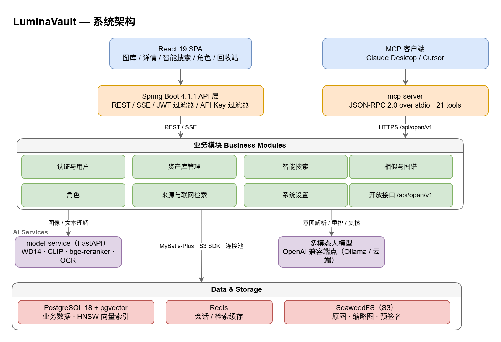
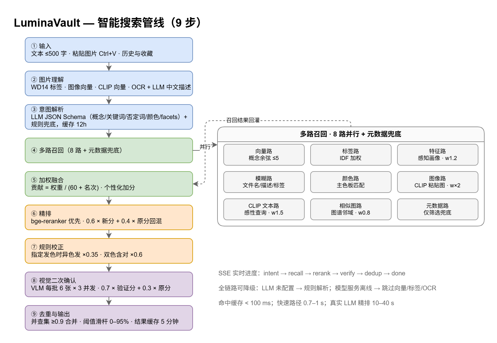
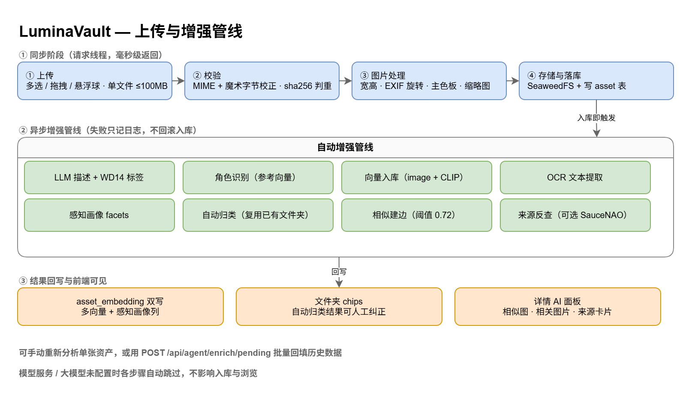
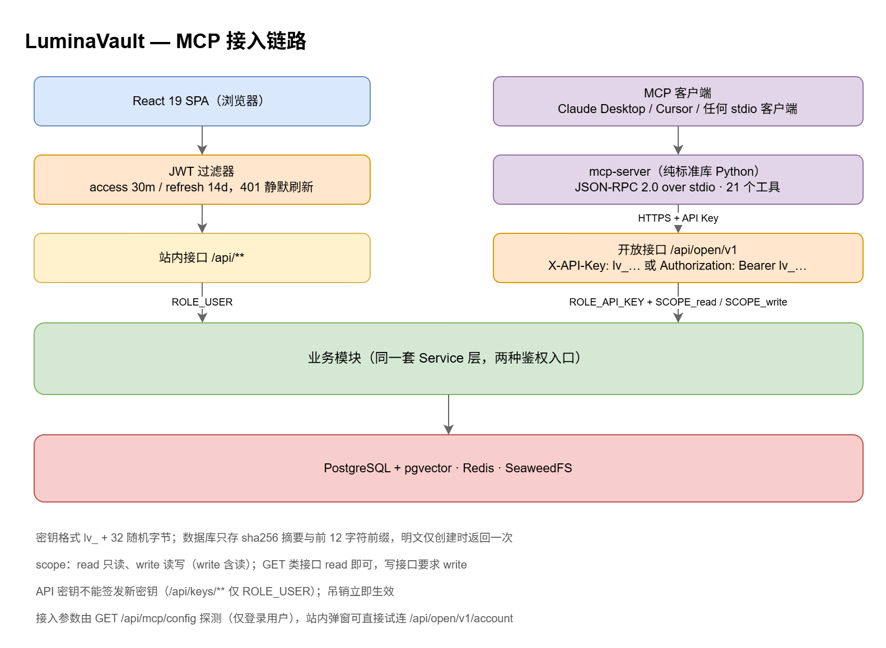

# LuminaVault

私有部署的 AI 增强图片资产库：自然语言搜图、相似图与图谱检索、上传即自动理解，并对外开放 MCP 接口让 AI 客户端直接管理图库。




---

## 为什么做这个项目

图片越攒越多之后，传统图库的三个假设会依次失效：

**1. 文件夹能组织一切。** 一开始按「日期 / 作者 / 主题」建目录还算清爽，等图到几千张，同一张图同时属于「某个角色」「某个场景」「某个画风」，只能挑一个文件夹放。改名、合并、重新归类全靠手工，代价高到没人愿意做，最后所有图沉在一个 `未分类` 里。

**2. 文件名和时间戳够用来检索。** 现实是想找「蓝发、雨天、侧脸、看上去很安静」的那张图。文件名是哈希，时间戳只记得大概，标签是上传时随手写的——没有任何一个字段能表达这种「感觉」。

**3. 图库放在别人的云上没关系。** 个人图库往往包含不想上传的原图、画师作品、私人照片。交给第三方云相册，隐私和可控性就一起交出去了。

另外还有第四个、更近才出现的问题：**AI 客户端够不着本地图库。** Claude Desktop、Cursor 这类工具能读写代码、能查网页，却没法问一句「我这个图库里有没有类似的图」，也没法把一批图整理进文件夹。图库成了一个封闭孤岛。

LuminaVault 就是针对这四件事做的：

| 它要解决的问题 | 本项目的做法 |
| --- | --- |
| 文件夹分类会失效 | 一张图可以属于多个文件夹；上传时自动归类，但归类结果可人工纠正，且优先复用已有文件夹而不是越建越多 |
| 关键词检索表达不了「感觉」 | 自然语言搜索：意图解析 → 多路召回 → 精排 → 视觉复核，支持颜色、发色、否定词、氛围词与粘贴图片搜索 |
| 云相册不可控 | 全本地部署，原图存私有对象存储，数据库、缓存、模型都在自己的机器上 |
| AI 客户端够不着图库 | 开放 API（`/api/open/v1`）+ 纯标准库实现的 MCP server，Claude Desktop / Cursor 可直接搜索、上传、管理图库 |

同时它坚持一条底线：**没有 GPU、没有配大模型、没有联网，系统依然能跑。** 检索、上传、浏览都有降级路径，AI 能力是增益而不是前提。

---

## 核心能力

| 模块 | 能力 |
| --- | --- |
| 认证与用户 | 注册 / 登录 / 刷新令牌，JWT access 30 分钟、refresh 14 天，401 静默续期 |
| 资产库 | 多选上传、拖拽、悬浮球快捷上传、sha256 判重、无限滚动懒加载、自然排序、批量操作、回收站 30 天 |
| 智能搜索 | 自然语言 + 粘贴图片搜索，SSE 实时进度，相似图可视化，反馈闭环 |
| 相似与图谱 | 以图搜图（毫秒级）、相关图片、资产相似度无向图（21 个可调参数） |
| 角色 | 标签命中 + 参考向量匹配，阈值可配，人工校准与批量标注 |
| 来源与联网检索 | SauceNAO 反查，自动填作者、补标签，限流与日配额 |
| 系统设置 | 明暗主题、6 套主题色、检索调优抽屉（参数即时生效） |
| 能力开放层 | API 密钥、`/api/open/v1` 开放 REST、MCP server、站内接入指引弹窗 |

---

## 系统架构

| 层 | 组成 |
| --- | --- |
| 客户端 | React 19 单页应用；MCP 客户端（Claude Desktop / Cursor 等支持 stdio 的工具） |
| 接入层 | Spring Boot 4.1.1：REST + SSE + JWT 过滤器 + API Key 过滤器；`mcp-server`：JSON-RPC 2.0 over stdio |
| 业务层 | 认证、资产、搜索、图谱、角色、来源、设置、开放接口八个模块，共用同一套 Service |
| AI 层 | `model-service`（FastAPI：WD14 标签、CLIP ViT-B/32、bge-reranker、OCR）；多模态大模型（任意 OpenAI 兼容端点） |
| 存储 | PostgreSQL 18 + pgvector（HNSW 向量索引）、Redis（会话与检索缓存）、SeaweedFS S3（原图与缩略图） |

两个入口走两种鉴权，落到的却是同一套业务逻辑：站内是 JWT（`ROLE_USER`），开放接口是 API 密钥（`ROLE_API_KEY` + `SCOPE_read` / `SCOPE_write`）。API 密钥过滤器排在 JWT 过滤器之前，避免 `lv_` 前缀的密钥被当作 JWT 解析。

---

## 智能搜索



一次搜索可以拆成九步：

1. **输入** —— 文本（≤500 字）或粘贴图片（`Ctrl+V`），带历史与收藏。
2. **图片理解**（有图片时）—— WD14 标签、图像向量、CLIP 向量、OCR，再加上大模型给出的中文描述，合成一个「有效查询」。
3. **意图解析** —— 大模型按 JSON Schema 输出概念、关键词、否定词、颜色、筛选条件、角色、改写和建议词（facets），失败时回落到规则解析，结果缓存 12 小时。
4. **多路召回** —— 八路并行 + 元数据兜底，见下表。
5. **加权融合** —— 每路贡献 `权重 / (60 + 名次)`，求和归一化；再叠加个性化：反馈亲和、反馈向量、感性偏好、壁纸加成、角色加分。
6. **精排** —— 候选池取 `limit × 3`（上限 36），优先用 bge-reranker，成功后不再叠一层大模型；分数按 `0.6 × 新分 + 0.4 × 原分` 回混，保留召回阶段的相对关系。
7. **规则校正** —— 查询指定了发色时，异色发降权、双色且含指定色降权，避免「白发被召回成金发」。
8. **视觉二次确认** —— 超过阈值的候选分批（默认 6 张、并发 3）送多模态模型复核，按 `0.7 × 验证分 + 0.3 × 原分` 融合；未确认的结果打上「未复核」标记而不是直接丢弃。
9. **去重与输出** —— 强相似边（≥0.9）用并查集合并、保留最高分，再按阈值过滤取前 `limit`，结果缓存 5 分钟。

八路召回：

| 召回路 | 依据 | 权重 |
| --- | --- | --- |
| 向量路 | 概念向量余弦（最多 5 个概念） | 1.0 |
| 标签路 | WD14 / 大模型标签，IDF 加权 | 1.0 |
| 特征路 | 查询 facets 与资产感知画像做同 facet 匹配 | 1.2 |
| 模糊路 | 文件名、描述、标签、角色名、文件夹名 | 1.0 |
| 颜色路 | 主色板匹配 | 1.0 |
| 图像路 | 粘贴图与库内 CLIP 向量相似 | 2.0 |
| CLIP 文本路 | 感性查询映射到 CLIP 文本空间 | 1.5 |
| 相似图路 | 从融合结果头部种子沿相似度图扩展 | 0.8 |
| 元数据路 | 仅用于筛选条件兜底 | — |

搜索过程通过 SSE 逐步推送（`progress` / `result` / `error`），前端把「无向图扩展」渲染成可展开的相似图面板：边宽与透明度对应边权，带流动光点动画，可重播与全屏。置信度滑杆范围 0–95%、默认 40%，选择会记在本地。

反馈会写回图谱：命中「选它」时给 1 跳邻居加分（`0.3 × 边权`）、2 跳少量加分，同时设阈值与上限防止回音室；「不相关」则反向抑制。评测口径为 MRR@10 与 Recall@50。

---

## 上传与增强管线



上传分两段：

**同步段**（请求线程，毫秒级返回）：上传 → 校验（MIME + 魔术字节校正，sha256 判重）→ 图片处理（宽高、EXIF 旋转、主色板、缩略图）→ 存 SeaweedFS 并落库。

**异步段**（入库即触发，失败只记日志、不回滚入库）：大模型描述 + WD14 标签 → 角色识别 → 向量入库（图像向量与 CLIP 向量双写）→ OCR → 感知画像（mood / style / tone / scene / usability 等 facets）→ 自动归类 → 相似建边 → 来源反查（可选）。

结果回写到三处：`asset_embedding`（多向量 + 感知画像列）、文件夹 chips（自动归类可人工纠正）、详情页 AI 面板（相似图、相关图片、来源卡片）。历史数据可用 `POST /api/agent/enrich/pending` 批量回填，单张资产也可手动重新分析。

---

## 相似与图谱

- **找相似**：WD14 图像路 + CLIP 路 + 标签相似路（IDF 覆盖度加权），用 RRF（k = 60）融合，pgvector HNSW 或内存余弦回退。不做大模型重排与视觉复核，所以是毫秒级。
- **相似度图**：节点是资产，边是加权相似度（`a_id < b_id` 只存一条）。双通道各取 12 个近邻融合，单通道时 ×0.9 折扣，阈值 0.72，每张图最多 10 条边。
- **生命周期**：启动时若图为空则后台重建；单资产分析完增量建边；CLIP 回填联动；外键级联清边；提供全量重建与边数统计接口。
- **图路召回**：头部 20 个种子，每个种子 8 个邻居，按名次衰减 1.0 / 0.6 / 0.3。
- **相关图片**：图谱邻居按边权降序，默认 12 张，双向。

21 个参数（边阈值、通道权重、种子数、衰减系数、反馈系数等）可以在配置文件、环境变量、前端「检索调优」抽屉三处设置，抽屉里改完即时生效，也可按当前参数一键重建图。

---

## MCP 与开放接口



### 密钥

- 格式 `lv_` + 32 随机字节（base64url，无 padding）。
- 数据库只存 sha256 摘要与前 12 字符前缀，**明文只在创建时返回一次**。
- 权限 `read`（只读）/ `write`（读写，含读），可选有效期（1–3650 天）。
- 认证支持 `X-API-Key: lv_xxx` 或 `Authorization: Bearer lv_xxx`。
- API 密钥不能签发新密钥（`/api/keys/**` 仅限登录用户），吊销立即生效。

### 开放接口

| 方法 | 路径 | 说明 |
| --- | --- | --- |
| GET | `/api/open/v1/account` | 当前密钥身份、权限与有效期 |
| GET | `/api/open/v1/stats` | 资产 / 回收站 / 文件夹 / 角色 / 相似边计数 |
| GET | `/api/open/v1/assets` | 分页列表（关键字、文件夹、未归类、排序） |
| GET | `/api/open/v1/assets/search` | 按文件名 / 作者检索 |
| POST | `/api/open/v1/assets` | 上传（multipart，`file` + `description` + `folderId`） |
| GET | `/api/open/v1/assets/{id}` | 详情 |
| PUT | `/api/open/v1/assets/{id}` | 修改元数据 |
| DELETE | `/api/open/v1/assets/{id}` | 移入回收站 |
| GET | `/api/open/v1/assets/{id}/content` | 直接返回图片字节（`thumbnail=true` 取缩略图） |
| GET | `/api/open/v1/assets/{id}/url` | 预签名下载 / 外链 |
| GET | `/api/open/v1/assets/{id}/similar` | 找相似 |
| GET | `/api/open/v1/assets/{id}/related` | 相关图片 |
| POST | `/api/open/v1/assets/similar-search` | 以图搜图（multipart） |
| GET | `/api/open/v1/trash` | 回收站 |
| POST | `/api/open/v1/assets/{id}/restore` | 恢复 |
| DELETE | `/api/open/v1/assets/{id}/purge` | 彻底删除 |
| POST | `/api/open/v1/search` | 自然语言 / 图片语义搜索 |
| POST | `/api/open/v1/search/attachment` | 上传搜索附件（粘贴图） |
| GET/POST/PUT/DELETE | `/api/open/v1/folders` | 文件夹增删改查与合并 |
| POST | `/api/open/v1/folders/{id}/assets` | 批量分配 / 追加 / 移除 |
| GET | `/api/open/v1/characters` | 角色列表 |
| POST | `/api/open/v1/assets/{id}/enrich` | 触发重新分析 |

### MCP server

`mcp-server/` 下是一个**不依赖任何第三方包**的 Python 实现（标准库即可跑），JSON-RPC 2.0 over stdio，提供 21 个工具：

| 分类 | 工具 |
| --- | --- |
| 账号 | `get_account`、`get_stats` |
| 浏览 | `list_assets`、`search_assets`、`get_asset`、`get_asset_image`、`list_trash` |
| 搜索 | `semantic_search`、`search_by_image`、`find_similar` |
| 写入 | `upload_asset`、`update_asset`、`delete_asset`、`restore_asset`、`purge_asset`、`enrich_asset` |
| 组织 | `list_folders`、`create_folder`、`delete_folder`、`assign_folder`、`list_characters` |

配置示例（Claude Desktop 的 `claude_desktop_config.json`）：

```json
{
  "mcpServers": {
    "lumina-vault": {
      "command": "python",
      "args": ["<仓库绝对路径>/mcp-server/lumina_vault_mcp.py"],
      "env": {
        "LUMINA_VAULT_URL": "http://localhost:8080",
        "LUMINA_VAULT_API_KEY": "lv_你的密钥"
      }
    }
  }
}
```

站内顶栏「MCP 接入」弹窗会探测脚本路径与后端地址，直接生成可复制的配置、提供冒烟命令，并能用当前密钥就地试连 `/api/open/v1/account`。

冒烟测试：

```bash
LUMINA_VAULT_API_KEY=lv_xxx python mcp-server/smoke_test.py
```

协议层 6 项 + 只读 5 项 + 写入 9 项 + 错误处理 2 项，共 22 项检查，全部通过时退出码为 0。

---

## 技术栈

| 面 | 选型 |
| --- | --- |
| 后端 | Java 21、Spring Boot 4.1.1、Spring Security、JJWT、MyBatis-Plus、Flyway、Actuator |
| 数据 | PostgreSQL 18 + pgvector（HNSW）、Redis 8、SeaweedFS 4.48（S3 兼容） |
| 前端 | React 19、Vite 6、Tailwind CSS 4、react-router-dom 7、TypeScript 5.7 |
| 图像 | Thumbnailator、metadata-extractor、TwelveMonkeys imageio-jpeg / imageio-webp |
| AI | FastAPI + ONNX Runtime（WD14、CLIP ViT-B/32、bge-reranker、OCR）、OpenAI 兼容多模态大模型 |
| 测试 | Spring Boot Test + H2（PostgreSQL 兼容模式），105 个用例 |

---

## 快速开始

### 1. 起依赖容器

```bash
docker compose up -d postgres redis seaweedfs
```

需要模型服务（标签 / 向量 / OCR）时再加一个 profile：

```bash
docker compose --profile models up -d model-service
```

### 2. 起后端

```bash
./mvnw spring-boot:run
```

默认监听 `http://localhost:8080`，Flyway 会自动建表（迁移脚本分通用与 PostgreSQL 专属两套）。

### 3. 起前端

```bash
cd frontend
npm install
npm run dev
```

打开 `http://localhost:5173`，先注册账号再登录。开发服务器把 `/api` 与 `/f/` 代理到 `http://localhost:8080`。

### 4. 可选：启用 AI

默认全部关闭，系统以「纯检索模式」运行。要启用，至少配一项：

```bash
export LUMINA_AI_ENABLED=true
export LUMINA_AI_BASE_URL=https://your-endpoint/v1
export LUMINA_AI_API_KEY=sk-xxx
export LUMINA_AI_CHAT_MODEL=your-vision-model
```

模型服务同理：

```bash
export LUMINA_MODEL_ENABLED=true
export LUMINA_MODEL_BASE_URL=http://localhost:8000
```

### 服务端口

| 端口 | 用途 |
| --- | --- |
| 8080 | 后端 API |
| 5173 | 前端开发服务器 |
| 5432 | PostgreSQL |
| 6379 | Redis |
| 8333 / 9333 / 8888 | SeaweedFS S3 / master / filer |
| 8000 | model-service |
| 9092 / 8100 | H2（仅测试与调试用的 TCP / Web 控制台） |

---

## 配置

所有配置都可用环境变量覆盖，未设置时使用括号内默认值。

### 数据与存储

| 变量 | 默认值 | 说明 |
| --- | --- | --- |
| `POSTGRES_URL` | `jdbc:postgresql://localhost:5432/lumina_vault` | 数据库连接串 |
| `POSTGRES_USER` | `lumina` | 数据库用户 |
| `POSTGRES_PASSWORD` | `lumina123` | 数据库口令（**部署前务必修改**） |
| `REDIS_HOST` / `REDIS_PORT` | `localhost` / `6379` | Redis |
| `REDIS_PASSWORD` | 空 | Redis 口令 |
| `LUMINA_STORAGE_ENDPOINT` | `http://localhost:8333` | 对象存储端点 |
| `LUMINA_STORAGE_REGION` | `us-east-1` | 区域 |
| `LUMINA_STORAGE_ACCESS_KEY` | `lumina` | 访问键 |
| `LUMINA_STORAGE_SECRET_KEY` | `lumina123` | 访问密钥（**部署前务必修改**） |
| `LUMINA_STORAGE_BUCKET` | `lumina-vault` | 桶名 |

### 安全

| 变量 | 默认值 | 说明 |
| --- | --- | --- |
| `LUMINA_JWT_SECRET` | `lumina-vault-dev-jwt-secret-change-me-0123456789` | JWT 签名密钥（**部署前务必修改**） |

### 资产与回收站

| 变量 | 默认值 | 说明 |
| --- | --- | --- |
| `LUMINA_ASSET_TRASH_RETENTION_DAYS` | `30` | 回收站保留天数 |
| `LUMINA_ASSET_PURGE_CRON` | `0 0 4 * * *` | 过期清理任务 |
| `LUMINA_ASSET_THUMBNAIL_MAX_SIZE` | `480` | 缩略图最长边 |

### 相似图与图谱

| 变量 | 默认值 | 说明 |
| --- | --- | --- |
| `LUMINA_GRAPH_ENABLED` | `true` | 是否建图 |
| `LUMINA_GRAPH_EDGE_THRESHOLD` | `0.72` | 建边阈值 |
| `LUMINA_GRAPH_MAX_EDGES` | `10` | 每张图最多边数 |
| `LUMINA_GRAPH_FETCH_PER_CHANNEL` | `12` | 单通道取近邻数 |
| `LUMINA_GRAPH_WD14_WEIGHT` / `LUMINA_GRAPH_CLIP_WEIGHT` | `0.6` / `0.4` | 双通道融合权重 |
| `LUMINA_GRAPH_SINGLE_CHANNEL_DISCOUNT` | `0.9` | 单通道折扣 |
| `LUMINA_GRAPH_DUPLICATE_THRESHOLD` | `0.9` | 判重阈值 |
| `LUMINA_GRAPH_ROUTE_WEIGHT` | `0.8` | 图路召回权重 |
| `LUMINA_GRAPH_ROUTE_SEED_LIMIT` / `LUMINA_GRAPH_ROUTE_NEIGHBORS` | `20` / `8` | 种子数 / 每种子邻居数 |
| `LUMINA_GRAPH_ROUTE_DECAY_NEAR` / `MID` / `FAR` | `1.0` / `0.6` / `0.3` | 名次衰减 |
| `LUMINA_GRAPH_FEEDBACK_1HOP` / `2HOP` | `0.3` / `0.1` | 反馈加权系数 |

### AI 与模型服务

| 变量 | 默认值 | 说明 |
| --- | --- | --- |
| `LUMINA_AI_ENABLED` | `false` | 是否启用大模型能力 |
| `LUMINA_AI_PROVIDER` | `ollama` | 供应商标识 |
| `LUMINA_AI_BASE_URL` / `LUMINA_AI_API_KEY` | 空 | OpenAI 兼容端点与密钥 |
| `LUMINA_AI_CHAT_MODEL` | 空 | 多模态对话模型 |
| `LUMINA_AI_VISION` / `RERANK` / `ANALYZE_QUERY` / `VERIFY` | `true` | 各能力开关 |
| `LUMINA_AI_QUERY_ANALYZE_TTL` | `12h` | 意图解析缓存 |
| `LUMINA_AI_VERIFY_BATCH_SIZE` / `CONCURRENCY` | `6` / `3` | 视觉复核批量与并发 |
| `LUMINA_AI_MAX_IMAGE_BYTES` | `10485760` | 送模型图片上限（超出自动压缩） |
| `LUMINA_AI_CONNECT_TIMEOUT` / `READ_TIMEOUT` | `30s` / `120s` | 超时 |
| `LUMINA_MODEL_ENABLED` | `false` | 是否启用本地模型服务 |
| `LUMINA_MODEL_BASE_URL` | `http://localhost:8000` | 模型服务地址 |
| `LUMINA_VECTOR_ENABLED` | `true` | 是否启用向量索引 |

### 角色与来源反查

| 变量 | 默认值 | 说明 |
| --- | --- | --- |
| `LUMINA_CHARACTER_AUTO_MATCH` / `AUTO_CREATE` | `true` / `false` | 自动匹配 / 自动新建角色 |
| `LUMINA_CHARACTER_MATCH_THRESHOLD` / `MARGIN` | `0.78` / `0.02` | 匹配阈值与余量 |
| `LUMINA_WEB_SEARCH_ENABLED` | `false` | 是否启用联网反查 |
| `LUMINA_WEB_SEARCH_API_KEY` | 空 | SauceNAO 密钥（自备） |
| `LUMINA_WEB_SEARCH_PROXY` | 空 | 反查代理 |
| `LUMINA_WEB_SEARCH_DAILY_QUOTA` / `DELAY_MS` | `2000` / `2000` | 日配额与限流间隔 |

### MCP server

| 变量 | 默认值 | 说明 |
| --- | --- | --- |
| `LUMINA_VAULT_URL` | `http://localhost:8080` | 后端地址 |
| `LUMINA_VAULT_API_KEY` | 空 | `lv_` 开头的密钥 |
| `LUMINA_VAULT_TIMEOUT` | `30` | 请求超时（秒） |

---

## 项目结构

```text
src/main/java/com/lumi/vault/
  auth/            认证与 JWT
  common/          统一响应、分页、异常
  config/          安全、MyBatis-Plus、存储、AI 等配置
  business/
    asset/         资产库、图片处理、存储抽象
    agent/         智能搜索管线与进度事件
    graph/         相似度图、召回、重建
    folder/        文件夹与自动归类
    character/     角色与参考向量
    websearch/     来源反查
    apikey/        API 密钥
    openapi/       开放接口（/api/open/v1）
    mcp/           MCP 接入参数探测
    perception/    感知画像
    vector/        向量检索
    model/         模型服务客户端
src/main/resources/
  application.yaml
  db/migration/            通用迁移（H2 亦可跑）
  db/migration-pg/         PostgreSQL 专属迁移
frontend/src/
  pages/          图库、详情、智能搜索、文件夹、角色、回收站
  components/     上传抽屉、检索面板、相似图面板、设置抽屉、密钥抽屉、MCP 指引弹窗
  api/            客户端与类型
model-service/    FastAPI 模型服务（WD14 / CLIP / reranker / OCR）
mcp-server/       MCP server、冒烟测试、接入文档
docs/             架构图与模块图
```

---

## 测试

```bash
./mvnw test
```

105 个用例，覆盖认证、资产、搜索、图谱、角色、来源、密钥与开放接口；测试用 H2（PostgreSQL 兼容模式）跑通用迁移，因此不依赖容器。

前端：

```bash
cd frontend
npx tsc -b
npm run build
```

---

## 设计取舍

- **降级优先于独占**：大模型不可用时退回规则解析并标注「未复核」；模型服务离线时跳过向量、标签、OCR；pgvector 不可用时退回内存余弦；联网反查可整体禁用且不阻塞上传。
- **MCP 零依赖**：`mcp-server` 只用 Python 标准库实现 JSON-RPC，不需要 `pip install`，便于在任何装了 Python 的机器上直接跑。
- **接入参数由后端探测**：脚本路径、解释器、后端端口由 `GET /api/mcp/config` 返回，而不是让前端自己拼，避免路径与端口写错（该接口仅登录用户可读）。
- **可调而非硬编码**：图谱 21 个参数、复核批量与并发、各类阈值都外置，调参不必改代码。
- **可观测的搜索**：搜索过程用 SSE 逐步推送，前端能看到走到了哪一步，而不是干等一个转圈。

---

## 文档

- [`需求分析.md`](需求分析.md) —— 功能模块、精度与时效指标、输入输出约定、数据库设计、环境要求
- [`mcp-server/README.md`](mcp-server/README.md) —— MCP 接入的完整说明与故障排查
- [`docs/module-hierarchy.drawio`](docs/module-hierarchy.drawio) —— 模块层次图源文件

---

## 安全须知

- `application.yaml` 与 `docker-compose.yaml` 里的数据库口令、对象存储密钥、JWT 密钥都是**开发默认值**，部署到任何非本机环境前必须通过环境变量覆盖。
- `.env` 已被 `.gitignore` 忽略，不会被提交。
- API 密钥明文只在创建时显示一次，数据库只留摘要；建议给只读用途单独签发 `read` 密钥。
- 开放接口按 scope 授权：读取类接口 `read` 即可，写入类接口需要 `write`。

## 许可证

本仓库暂未声明开源许可证。如需在他人项目中使用，请先联系作者。
