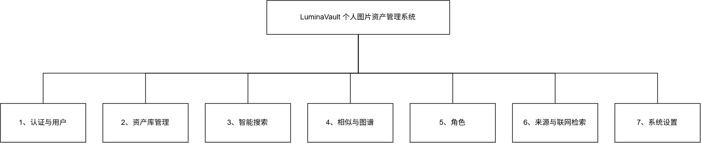

# LuminaVault 需求分析

## 1 概述

### 1.1 编写目的

本文档用于定义 LuminaVault（个人图片资产管理网站）的完整需求，作为系统设计、开发实现、测试验收与后续迭代的依据。

本文档的预期读者包括：项目开发者本人（兼产品与测试角色）、后续可能的协作者，以及希望了解系统能力边界与运行条件的使用者。

文档在系统主体功能完成后回写整理（"事后诸葛亮"式），因此内容与实际实现严格对齐，可作为"能力现状说明书 + 验收基线"使用：凡本文档描述的功能均已在系统中实现并经过自动化测试或真机验证；凡未描述的功能均不在当前范围内。

### 1.2 项目背景

个人收藏的插画、壁纸类图片数量持续增长（典型规模：数百至数万张），传统"文件夹 + 文件名"的管理方式存在三个核心痛点：

1. **找不到**：只记得"画面大概是什么样"，记不住文件名或存放位置；纯关键词检索依赖文件名，而图片文件名普遍无意义（如 `2.jpg`、`1094.png`）。
2. **理不清**：手工分类维护成本高、易失控；出现近似主题的文件夹不断增生（如"星空夜景 / 星空幻想 / 海边星空"并存）。
3. **用不上**：图片内的文字信息（标题、对白、水印）、相似构图与同角色图片、图片来源（画师 / 作品页）都无法直接利用。

与此同时，技术条件已经成熟：本地 ONNX 模型（WD14 标签器、CLIP、cross-encoder、OCR）可在无 GPU 的个人电脑上运行；兼容 OpenAI 协议的多模态大模型（视觉理解、意图拆解、重排、看图复核）可按量调用；PostgreSQL + pgvector 提供了生产级的向量检索能力。据此提出本项目：构建一个**私有部署、AI 增强**的个人图片资产管理系统，实现从"文件名管理"到"语义与视觉管理"的升级。

项目名称 LuminaVault 寓意"光的仓库"（Lumina = 光，Vault = 库），界面按个人图库的使用习惯设计（深色星空背景、浮入浮出动效、吸顶隐藏工具栏等）。

### 1.3 可行性分析

**技术可行性**

- 后端以 Spring Boot（Java 21）实现业务与编排，成熟的 MyBatis-Plus / Flyway / Spring Security 生态覆盖数据访问、迁移与认证；
- 向量检索使用 pgvector（HNSW 索引）承载生产规模，小库/测试环境自动回退内存余弦，不绑定单一数据库能力；
- 本地模型服务以 Python FastAPI 独立部署（Docker），提供标签、向量、重排、OCR 四类推理；大模型调用走标准 OpenAI 兼容接口，供应商可替换；
- 前端 React 19 + Vite + Tailwind，已实现无限滚动懒加载、SSE 实时进度、图谱可视化等交互，均为成熟技术组合。

**经济可行性**

全部组件开源（PostgreSQL/pgvector、Redis、SeaweedFS、FastAPI、React 均免费），无商业授权成本；本地模型推理零边际成本；大模型按量付费且通过"意图缓存、结果缓存、候选池上限、批量确认"等手段控制调用量；整套系统可运行在单台个人电脑上。

**运行可行性**

单用户/家庭私有部署；Docker Compose 一键起基础设施；后端、前端、模型服务三个进程独立启停；系统为全链路设计了降级路径（见 3.3.3），任一侧服务不可用时不阻塞基础使用（浏览、上传、文件管理），AI 能力按可用性逐级启用。

**法律与隐私可行性**

资产文件、分析结果、向量数据全部存储在本地，不外传（除用户主动触发的"来源反查"与"联网搜索"功能，且出口可配置代理、可整体关闭）；联网来源查询默认限流并设日配额。

**结论**：项目在技术、经济、运行与隐私层面均可行，且已完成实现与验证。

## 2 任务概述

### 2.1 目标

构建一个**私有、AI 增强、可配置、可降级**的个人图片资产管理系统，达成以下目标：

1. **管理目标**：完成图片的导入（含批量）、浏览、整理（文件夹多归属/批量操作/回收站）、检索（文件名/作者/自然语言/图片）与预览下载全流程；
2. **智能目标**：
   - 自然语言搜索：用"白头发的女孩子""适合桌面使用的壁纸"这类描述直接找图，而非猜文件名；
   - 以图搜图：上传或**粘贴**任意图片找相似；支持"图片 + 文字"组合、纯图片、读图中文字找内容四种用法；
   - 自动整理：新图自动分析（描述/标签/角色/主色/OCR）并自动归类，且**优先复用已有文件夹**；
   - 关系组织：维护图与图之间的相似度**无向图**，支撑多跳召回、结果去重、反馈传播与"相关图片"浏览；
3. **体验目标**：滚动与加载"无感化"（无卡顿、无等待感），检索过程实时可见（真实进度而非假动画），深浅主题与背景可定制；
4. **可维护目标**：全部算法参数配置文件 + 前端双通道可调；异常自动降级；数据版本化迁移。

### 2.2 用户特点

- **用户构成**：系统的所有者本人——个人插画/壁纸收藏者；单用户使用（系统按私有部署设计，认证体系支持多账号但资产库全局共享）。
- **技术背景**：具备基本的电脑操作能力，会使用浏览器与文件管理器；不需要理解向量、RAG 等概念，界面不暴露技术细节。
- **使用场景与期望**：
  - 频繁浏览图库（每日多次），对滚动流畅度极敏感，要求"加载不打断浏览"；
  - 有明确的目标图片但记不住文件名，期望"描述就能找到"；
  - 偶尔整理图库（批量移动/删除/归类），期望一次操作多张；
  - 对隐私敏感，期望数据本地化、联网能力可关；
  - 对"AI 黑盒"有戒心，要求可看到检索过程（进度、途经节点）、可调置信度阈值、可对结果做反馈校正。

## 3 需求规定

### 3.1 功能描述

系统按"资产库 + 智能检索 + 组织与关系 + 辅助能力"四个方向组织功能，共七个功能模块：

- **认证与用户模块**：注册、登录、令牌刷新、登出；
- **资产库管理模块**：上传（含上传抽屉）、列表浏览（懒加载/排序/筛选）、详情与编辑、批量操作、回收站、文件夹归属（多归属）与文件夹管理；
- **智能搜索模块**：自然语言搜索、粘贴图片搜索、检索过程可视化、置信度阈值、搜索历史与收藏、结果反馈；
- **相似与图谱模块**：找相似（以图搜图）、相似度无向图（图路召回/去重/反馈传播）、相关图片；
- **角色模块**：角色识别、参考向量维护、人工校准、批量标注；
- **来源与联网检索模块**：来源反查（SauceNAO）、Web 来源展示；
- **系统设置模块**：外观设置（主题/背景/自定义 CSS）、检索调优（相似图参数前端可调）。

### 3.1.1 系统功能层次模块图



> 图源文件：`docs/module-hierarchy.drawio`（draw.io 直接打开可编辑，改完导出图片即可替换）；下方为同一层次的逐级展开明细，与上图的一级模块一一对应。

```
LuminaVault
├─ 1 认证与用户
│  ├─ 1.1 注册 / 登录 / 登出
│  └─ 1.2 JWT 访问令牌 + 刷新令牌
├─ 2 资产库管理
│  ├─ 2.1 上传
│  │  ├─ 2.1.1 单张 / 多选上传（上传抽屉：逐张进度、悬浮球、自动清理、自动收起）
│  │  ├─ 2.1.2 重复检测（sha256）与非图片拦截
│  │  ├─ 2.1.3 元数据提取（尺寸 / EXIF / 主色板）、缩略图生成
│  │  └─ 2.1.4 入库自动管线（AI 分析 → 标签 / 角色 / 向量 / OCR → 自动归类 → 来源查询）
│  ├─ 2.2 浏览
│  │  ├─ 2.2.1 图库网格（无限滚动 + 计数窗口懒加载 + 空闲预取 + 浮入浮出动效）
│  │  ├─ 2.2.2 工具栏（搜索 / 精确匹配 / 批量入口 / 排序 / 上传，随滚动隐藏与浮回）
│  │  ├─ 2.2.3 文件夹筛选（chips 横向滚动）
│  │  └─ 2.2.4 空白处右键菜单（选择 / 自动分类 / 刷新图片）
│  ├─ 2.3 详情页
│  │  ├─ 2.3.1 大图预览（点击放大灯箱）、下载原图、复制外链
│  │  ├─ 2.3.2 编辑（文件名 / 作者 / 描述）与「重新分析」
│  │  ├─ 2.3.3 找相似 / 相关图片（图谱邻居）
│  │  ├─ 2.3.4 多文件夹归属（chips + 添加/移除）
│  │  ├─ 2.3.5 角色校准（校准为 / 新建并校准）
│  │  ├─ 2.3.6 来源卡片（画师 / 作品页 / 相似度）
│  │  └─ 2.3.7 返回来源识别（从图库/搜索正确返回）
│  ├─ 2.4 批量操作（上限 100/次）
│  │  ├─ 2.4.1 批量移动 / 加入 / 移出文件夹
│  │  ├─ 2.4.2 批量删除（入回收站）
│  │  ├─ 2.4.3 批量分类（Agent）与批量标角色
│  │  └─ 2.4.4 卡片右键菜单（移动到文件夹 / 移入回收站 / 查找来源）
│  ├─ 2.5 回收站
│  │  ├─ 2.5.1 恢复 / 彻底删除（单个与批量）
│  │  └─ 2.5.2 保留期可配（默认 30 天，定时清理）
│  └─ 2.6 文件夹
│     ├─ 2.6.1 CRUD（新建 / 重命名 / 删除，删除后图片退回未分类）
│     ├─ 2.6.2 合并（成员迁入目标后删除源）
│     └─ 2.6.3 多归属关系（add / remove / 替换语义）
├─ 3 智能搜索
│  ├─ 3.1 查询入口
│  │  ├─ 3.1.1 自然语言输入（≤500 字）
│  │  ├─ 3.1.2 粘贴图片（图片 / 图片+文字）
│  │  └─ 3.1.3 历史与收藏（保存本次结果）
│  ├─ 3.2 检索管线
│  │  ├─ 3.2.1 查询理解（LLM 意图拆解 + 规则解析降级，12h 缓存）
│  │  ├─ 3.2.2 图片理解（WD14 标签 / 图像向量 / CLIP 向量 / OCR / LLM 视觉描述）
│  │  ├─ 3.2.3 多路召回（向量 / 标签 IDF / 模糊 / 颜色 / 图像 / CLIP / 相似图）
│  │  ├─ 3.2.4 加权 RRF 融合与个性化（反馈亲和 / 用户向量 / 角色命中）
│  │  ├─ 3.2.5 精排（本地 cross-encoder / LLM 重排）
│  │  ├─ 3.2.6 规则校正（发色矛盾惩罚）
│  │  ├─ 3.2.7 视觉二次确认（超过阈值全部确认，分批调用）
│  │  └─ 3.2.8 近重复去重（图谱强边）
│  ├─ 3.3 交互与呈现
│  │  ├─ 3.3.1 SSE 实时进度（真实阶段事件）
│  │  ├─ 3.3.2 搜索过程节点面板（固定管线 + 真实数据）
│  │  ├─ 3.3.3 相似图可视化面板（缩略图节点 + 边动画 + 查找闪烁 + 全屏）
│  │  ├─ 3.3.4 置信度阈值滑杆（0–95%，本地持久化）
│  │  └─ 3.3.5 未复核标记（超过阈值但未经视觉确认的结果）
│  └─ 3.4 反馈闭环
│     ├─ 3.4.1 选它 / 不相关
│     ├─ 3.4.2 反馈沿相似图传播（1–2 跳衰减）
│     └─ 3.4.3 检索效果评估（MRR@10 / Recall@50）
├─ 4 相似与图谱
│  ├─ 4.1 找相似（WD14 + CLIP + 标签 IDF 三路 RRF；向量不可用时回退图谱邻居）
│  ├─ 4.2 相似度无向图
│  │  ├─ 4.2.1 建边（双通道融合、阈值、每图边数上限）
│  │  ├─ 4.2.2 生命周期（启动自建、分析完成增量重建、CLIP 回填联动、级联清理）
│  │  ├─ 4.2.3 图路召回（种子扩展 + 跳数衰减）
│  │  ├─ 4.2.4 结果近重复去重
│  │  ├─ 4.2.5 反馈传播
│  │  └─ 4.2.6 参数配置（21 项：文件/环境变量 + 前端设置抽屉，即时生效）
│  └─ 4.3 相关图片（详情页图谱邻居区块）
├─ 5 角色
│  ├─ 5.1 角色列表与详情（参考图、出现次数）
│  ├─ 5.2 自动识别（标签命中 / 向量匹配）
│  ├─ 5.3 人工校准（校准为指定角色 / 新建并校准，含参考向量纠偏）
│  └─ 5.4 批量标注角色
├─ 6 来源与联网检索
│  ├─ 6.1 来源反查（SauceNAO：自动 / 手动 / 批量触发，限流 + 日配额 + 代理可配）
│  ├─ 6.2 来源展示（作者自动填充、角色并入标签、删除资产时清理）
│  └─ 6.3 联网能力总开关（默认关，可整体禁用）
└─ 7 系统设置
   ├─ 7.1 外观（亮/暗/跟随系统、6 套主题色、背景：主题/纯色/图片、自定义 CSS）
   └─ 7.2 检索调优（相似图 21 项参数：建边/图路/反馈传播/去重，保存即时生效、可恢复默认、可重建图）
```

### 3.2 各模块功能描述

#### 3.2.1 认证与用户（模块 1）

- **注册 / 登录 / 登出**：用户名 + 密码注册；登录签发 JWT 访问令牌（默认 30 分钟）与刷新令牌（默认 14 天）；前端在 401 时自动静默刷新，刷新失败跳转登录页。
- **约束**：密码加密存储；除注册/登录/刷新外的全部接口需要认证。

#### 3.2.2 资产库管理（模块 2）

**上传（2.1）**

- 支持单张与多选上传；上传期间显示**上传抽屉**：逐张进度、失败原因（重复 / 非图片 / 超限）；抽屉收起后以右下**悬浮球**提示状态（上传中数量 / 成功 / 失败）；
- **自动清理**：单次上传成功超过 5 张时自动清空已完成项；全部完成后延迟约 3 秒自动收起抽屉并弹出通知；期间列表内同类阶段进度就地更新，不逐条堆积；
- 重复检测：以 sha256 判重，重复文件拒绝入库并提示；
- 入库处理：生成缩略图（PNG 入 PNG、其余入 JPEG）、提取宽高 / EXIF / 主色板；
- **入库自动管线**（可分解关闭）：LLM 视觉描述 + WD14 标签 → 角色识别 → WD14 图像向量与 CLIP 向量 → OCR（装则启用）→ 自动归类（见下）→ 相似图建边 → （可配）来源反查；
- **自动归类规则（重要）**：必须**优先复用已有文件夹**——只要已有文件夹主题相关/接近/粗细同类即归入；仅当所有已有文件夹都明显不适配才新建，且新名 2–6 字、宽泛、不得与已有文件夹近义；系统另有"近义名守卫"兜底（包含关系或 2-gram 相似度 ≥0.5 时直接复用最接近的文件夹，不新建）；
- 上传时可指定目标文件夹（选择文件夹后 Agent 不再自动分类）。

**浏览（2.2）**

- 图库网格支持 **无限滚动懒加载**：首屏按视口行列数 + 20 张动态计算页大小；滚动到底部前 1200px 预取下一页；**空闲静默预取**下一页并预载窗口（将加载/解码成本移出滚动路径）；超出屏幕的卡片下沉（位移 + 缩放 + 模糊 + 淡出），滚回时浮入；新出现的卡片错峰浮现——整体要求滚动"无感"（详见 3.3.2）；
- 工具栏（搜索 / 作者 / 精确匹配 / 排序 / 批量操作 / 上传）：向下滚动隐藏、任意向上滚动立即浮回、回到顶部强制显示；
- 搜索：文件名模糊匹配、作者模糊匹配、精确匹配开关；重置按钮；
- 排序：文件名 A→Z（**默认，数字按数值自然排序**，如 109 < 110 < 1094）、文件名 Z→A、最新上传、最早上传、最大文件；**后续懒加载与翻页严格沿用当前排序**；排序偏好本地持久化；
- 文件夹筛选：全部图片 / 未分类 / 各文件夹（chips 横向滚动；悬停滚轮横向滚动；chips 悬停出现批量入口与文件夹管理入口）；
- 空白处右键菜单：**选择**（进入批量模式/退出）、**自动分类**（对所有未分类图片按规则归类，含确认与结果提示）、**刷新图片**。

**详情页（2.3）**

- 大图预览（点击放大灯箱，再点或 Esc 关闭）、下载原图、复制外链；
- 编辑文件名 / 作者 / 描述；「重新分析」重新执行 AI 分析；
- 「找相似」（见 4.1）与「相关图片」（图谱邻居，见 4.3）；
- 多文件夹归属 chips（可添加 / 移除，一张图可属多个文件夹）；
- 角色校准：将当前图片指定为某角色（或新建角色），并据此修正参考向量；
- AI 分析面板：状态（DONE/FAILED/SKIPPED）、模型、描述、标签；失败可重试；
- 来源卡片（见 6.2）；
- 返回按钮按来源正确返回：从搜索进入→返回搜索；从图库进入→返回图库；直接打开→按历史后退。

**批量操作（2.4）**

- 进入批量模式后卡片可勾选；提供批量移动 / 删除 / 分类 / 标角色；
- 单次上限 100 张；操作后自动退出批量模式并刷新；
- 卡片右键菜单：移动到文件夹 / 移入回收站 / 查找来源。

**回收站（2.5）**

- 展示已删除资产（含删除时间、保留到期时间）；支持单个与批量恢复、彻底删除；
- 保留期默认 30 天且可配置；到期自动清理（定时任务）。

**文件夹（2.6）**

- 新建（名称 + 描述）、重命名（含描述）、删除（删除后其中图片退回"未分类"）；
- **合并**：把源文件夹的全部图片迁入目标文件夹（保留原有归属）后删除源文件夹，用于治理文件夹增生；
- 管理页面（模块 7 入口之一，独立页面）：列表展示名称 / 来源（自动标记）/ 描述 / 创建时间 / 图片数，提供新建、重命名、合并、删除操作。

#### 3.2.3 智能搜索（模块 3）

**输入形式（3.1）**

- 自然语言文本（≤500 字）；
- 粘贴图片：直接 Ctrl+V 粘贴到搜索卡片，支持「图片 + 文字」「纯图片」两种提交方式；纯图片搜索即"以图搜图"，图片中的文字会被 OCR 读取并参与文本检索；
- 历史（自动记录查询词，点击重搜）与收藏（保存本次结果，可展开查看缩略图）。

**检索管线（3.2）**（核心，按执行顺序）

1. **图片理解**（有粘贴图时）：本地模型服务产出 WD14 标签 / 图像向量 / CLIP 向量 / OCR 文字；LLM 产出中文描述；与用户文字合并为"有效查询"（参与后续所有文本环节）；图片标签并入标签路；
2. **意图解析**：LLM 按 JSON Schema 输出概念、关键词、否定词、颜色、筛选条件（方向/时间/作者/相机/分辨率）、角色提示、查询改写与**感性特征 facets**（mood/style/tone/scene/usability → 规范词）；LLM 不可用时降级为规则解析（同义词/颜色词典/否定词/筛选正则），感受词由规则词典（`perception/query-lexicon.txt`）兜底提取，两路合并去重，结果缓存 12 小时；
3. **多路召回**：
   - 向量路：查询向量（多概念，至多 5 个）对图片文本向量（描述嵌入）求余弦；
   - 标签路：IDF 加权的标签匹配；
   - 特征路：查询 facets（含词典扩展）对资产**感知画像**做同 facet 的 IDF 匹配（精确匹配计全分、包含关系计半分，权重 1.2）；
   - 模糊路：查询词对文件名/描述/标签/角色名/文件夹名的模糊匹配；
   - 颜色路：查询颜色对主色板匹配；
   - 图像路 / CLIP 路：粘贴图片的 WD14/CLIP 向量对库内对应向量求余弦（**权重 ×2**，以图搜图为主诉求）；
   - CLIP 文本路：感性查询（facets 非空）时把描述编码到 CLIP 文本空间，与库内 CLIP 图向量匹配（权重 1.5，低相似度过滤）；
   - 相似图路：以融合头部为种子沿无向图扩展邻居（权重 0.8，按种子名次衰减）；
   - 元数据路：仅有筛选条件时的兜底；
4. **加权融合**：各路线内按分数排位，`贡献 = 权重 / (60 + 名次)` 求和并归一化；叠加个性化：反馈亲和（tanh 压缩）、用户反馈向量相似、**感性偏好**（反馈资产画像的 facet 值累计，tanh 压缩）、**壁纸适配加分**（查询诉求为壁纸时按画像壁纸分 ×0.25）、角色命中加分；
5. **精排**：取候选池（`limit×3`，至多 36 张）；本地 cross-encoder（bge-reranker）可用时优先执行，**成功即不再叠加 LLM 重排**；本地不可用时才走 LLM 重排；均按 `0.6×新分 + 0.4×原分` 回混；
6. **规则校正**：查询明确指定发色时，描述/标签中的异色发（如查询白发而图为粉发）降权 ×0.35；双色含对（如白+蓝混色）降权 ×0.6；无发色信息不罚；
7. **视觉二次确认**：对**所有超过置信度阈值的候选**（无阈值时为将返回的前 limit 名）分批（默认每批 6 张，可配）**并发**（默认 3 并发，可配）交给视觉大模型看图复核，按 `0.7×验证分 + 0.3×原分` 修正置信度；描述含主观感受（温馨/治愈/适合壁纸等）时明确提示模型重点核对画面氛围、色调与用途；**送模型的图片统一为缩略图/压缩小图（≤512px，粘贴图理解压至 ≤1024px）**——图像信息另有元数据提供，图片只需"看得清"；无硬性张数上限；未被确认但超过阈值的结果打「未复核」标记；
8. **近重复去重**：图谱强边（≥ 去重阈值，默认 0.9）做并查集分组，同组结果只保留得分最高的一张；
9. **输出**：按置信度阈值过滤后取 limit 条；结果缓存默认 5 分钟（同用户同查询）；命中缓存时直接返回并提示。

**交互与呈现（3.3）**

- **实时进度（SSE）**：搜索过程通过服务端推送真实阶段事件（意图解析 / 多路召回 / 无向图扩展 / 精排 / 规则校正 / 视觉确认 / 去重 / 完成），每条事件携带结构化数据（各路召回数量、图扩展种子与邻居数、校正张数、去重抑制数、最终结果与确认统计）；前端按阶段就地更新单行，不做假动画；
- **搜索过程节点面板**：独立板块，固定管线顺序展示完整流程；进行中节点转圈、完成节点打勾并展示真实数值、未触发节点置灰；其中「无向图扩展」节点可点击**开合下方的相似图面板**（打开时自动滚动到面板）；
- **相似图可视化面板**：绘制本次搜索实际经过的相似子图——缩略图为节点（点击灯箱放大原图），发光贝塞尔边为查找路径（按边权显示粗细与透明度）；播放查找动画：种子依次浮现 → 边逐条绘制并伴随流动光点 → 经过的邻居节点逐个闪烁；支持重播与全屏模式；
- **置信度阈值滑杆**：0–95%（默认 40%），本地持久化；低于阈值的已有结果即时隐藏并计数提示；滑杆值同时作为后端过滤与视觉确认范围依据；
- **未复核标记**：超过阈值但未经视觉确认的结果显示琥珀色「未复核」徽标（悬停说明），提示结果可信度层级。

**反馈闭环（3.4）**

- 每条结果提供「选它 / 不相关」：正向增加该图亲和权重并积累参考向量（用于角色参考与个性化），负向降低；
- **反馈传播**：点赞/差评沿相似图扩散——1 跳 ×0.3×边权、2 跳 ×0.1×两段边权；已有直接反馈的资产不叠加，防止回音室放大；
- **效果评估**：评测接口输出 MRR@10 / Recall@50（基于用户反馈对）。

**特征聚合（3.5）**（感性描述检索）

- **三层聚合**：① 规则层——WD14 标签经 `perception/tag-facets.txt` 映射、主色板判冷暖/明暗、尺寸与构图算壁纸适配分；② 语义层——视觉大模型在图片分析时直接产出氛围/风格/色调/场景/用途词（与描述、标签同一次调用，不增加调用次数）；③ 确认层——视觉二次确认对主观描述给出专门核对提示；
- **存储与回填**：聚合结果（感知画像 JSON）存于 `asset_embedding.perception`，新图入库自动生成；存量图通过 `POST /api/agent/perception/pending` 一键回填（保留既有 LLM 特征，重算规则层）；
- **词典与参数不写死在代码**：映射词典为资源文件（`query-lexicon.txt` / `tag-facets.txt`，与查询同义词表同一套维护方式）；壁纸评分权重与阈值走 `lumina.perception.*`（配置文件/环境变量可调）；
- **全链路接通**：理解（facets + 词典）、召回（特征路 + CLIP 文本路）、重排（画像词拼入精排文档）、确认（感性强调）、反馈（感性偏好沿反馈积累并作用于打分）。

#### 3.2.4 相似与图谱（模块 4）

**找相似（4.1）**

- 入口：详情页「找相似」按钮；搜索页粘贴图片（纯图片）亦等效；
- 算法：查询图自身已存向量（或现场计算）走 WD14 图像路 + CLIP 路 + 标签相似路（IDF 加权覆盖度，权重 ×2.5），RRF 融合（k=60）；展示相似度为向量余弦映射值；
- 双通道近邻使用 pgvector HNSW（生产）或内存余弦（回退）；结果为空的完全降级场景下回退**图谱邻居**；
- 与搜索的区别：找相似不做 LLM 重排与视觉确认，毫秒级返回，用于快速浏览。

**相似度无向图（4.2）**

- 结构：节点 = 资产，边 = 加权相似度（**无向**，对称仅存一条，约束 `a_id < b_id`）；边权 = WD14 与 CLIP 双通道融合分（0.6/0.4，单通道 ×0.9 折减）；
- 建边：双通道各取近邻（默认 12）→ 融合 → 阈值（默认 0.72）→ 每图保留至多 10 条边；边记录各通道分数；
- 生命周期：启动时图为空则后台自动重建；单个资产分析完成后**增量重建其边**；CLIP 回填联动重建；资产物理删除时外键级联清边；提供全量重建接口与边数统计接口；
- **图路召回**：搜索融合头部 20 个种子 → 每种子取图邻居（默认 8）→ 按种子名次衰减（近档 1.0 / 中档 0.6 / 远档 0.3）→ 作为独立路线并入融合；
- **近重复去重**：见 3.2.3 第 8 步；
- **反馈传播**：见 3.4；
- **参数配置**：全部 21 项参数（开关、边阈值、边数上限、近邻数、通道权重、折减、去重阈值、图路权重/种子数/邻居数/名次与衰减、反馈 1/2 跳系数/边阈/上限）支持**配置文件/环境变量**与**前端设置抽屉**双通道调整；前端保存即时生效（无需重启），可一键恢复默认，并可「按当前参数重建图」。

**相关图片（4.3）**

- 详情页展示该图的图谱邻居（按边权降序，默认 12 个，含相似度）；关系稳定、双向（A 出现在 B 的邻居里 ⇔ B 出现在 A 的邻居里）。

#### 3.2.5 角色模块（5）

- 角色列表（名称、参考图、出现次数）与详情；
- 自动识别：两种信号——WD14 标签命中角色名、图像向量与角色参考向量匹配（阈值与余量可配）；识别结果带置信度；
- 人工校准：在详情页把当前图「校准为」指定角色，或将错误参考向量剔除（校准会删除该图对其它角色的参考贡献），也可「新建并校准」；
- 批量标注：图库批量条支持一次为多张图指定角色。

#### 3.2.6 来源与联网检索（6）

- **来源反查**：调用 SauceNAO（需自备 API Key，可配置代理），支持上传后自动触发（可关）、详情页手动触发、图库批量触发；
- 结果：画师名自动填入资产作者、角色名并入标签、来源页链接与相似度展示在详情页来源卡片；
- 治理：请求限流（默认 2 秒/次）、日配额（默认 2000）、超额自动暂停；删除资产时一并清理来源数据；
- 联网能力整体可禁用；默认不阻塞上传与检索主流程（后台队列处理）。

#### 3.2.7 系统设置（7）

- **外观**：颜色模式（亮 / 暗 / 跟随系统）、6 套主题色（青瓷 / 墨 / 海蓝 / 紫罗兰 / 绯红 / 琥珀）、背景（跟随主题 / 纯色 / 自定义图片）、自定义 CSS；
- **检索调优（设置抽屉）**：相似图全部参数分组展示（建边 / 图路召回 / 反馈传播 / 结果去重），已被调整的参数高亮标注、悬停显示默认值；保存即时生效、可恢复默认；展示当前图边数并支持「按当前参数重建图」。

#### 3.2.8 开放接口与 MCP（能力开放层）

> 说明：本节不是第八个业务模块，而是把既有模块（认证、资产库、智能搜索、角色、文件夹）**以 API 密钥方式对外开放**的接入层，供 MCP 客户端（Claude Desktop、Cursor 等）与自建脚本远程调用。业务语义仍以 3.2.1–3.2.7 为准。

- **API 密钥**：格式 `lv_` + 32 字节随机数的 base64url；服务端只保存 sha256 摘要与 12 字符前缀，明文仅在创建响应中返回一次；支持名称（≤100 字）、权限（read / write，缺省两者）、有效期（1–3650 天，可留空为长期）；支持列表、吊销（吊销立即失效）；前端入口为顶栏「API 密钥」独立抽屉，密钥列表展示前缀、权限、创建/最近使用/到期时间，吊销需二次确认。
- **鉴权方式**：请求头 `X-API-Key: lv_…` 或 `Authorization: Bearer lv_…`；过滤器在 JWT 过滤器之前执行，分别授予 `ROLE_API_KEY` 与 `SCOPE_read` / `SCOPE_write`。密钥**不能**用于签发或吊销密钥（`/api/keys/**` 仅限登录用户 `ROLE_USER`），越权写入返回 403。
- **开放接口（前缀 `/api/open/v1`）**：资产（分页 / 文件名作者搜索 / 上传 / 详情 / 修改 / 删除 / 回收站 / 恢复 / 彻底删除 / 预签名 URL / **原图与缩略图字节流** / 相似 / 图谱邻居 / 以图搜图）、语义搜索（复用站内检索管线与附件通道）、图库管理（账户与权限、统计、文件夹增删改与批量分配、角色列表、按需触发 AI 分析）。全部沿用站内统一 `Result{code,message,data}` 与分页结构。
- **MCP Server**：`mcp-server/lumina_vault_mcp.py`，**纯 Python 标准库实现（零第三方依赖）**，JSON-RPC 2.0 over stdio（协议 2024-11-05），提供 21 个工具：账户/统计、资产列表与搜索、语义搜索与以图搜图、资产详情与图片内联（>4MB 提示改用缩略图）、上传/修改/删除/恢复/彻底删除（默认 dryRun，需 `confirm=true` 才真删）、找相似、文件夹增删与分配、角色列表、按需 AI 分析。配置通过环境变量 `LUMINA_VAULT_URL` / `LUMINA_VAULT_API_KEY` / `LUMINA_VAULT_TIMEOUT`。
- **验证**：`mcp-server/smoke_test.py` 可自证——无密钥时校验协议层（initialize / tools/list / ping），带密钥时端到端跑读写全链路（实测 22 项全通过）；后端集成测试 `ApiKeyFlowTests` 覆盖签发、权限隔离、吊销即时失效、非法 scope 拒绝、接入配置接口的登录/密钥权限边界。
- **站内接入指引（独立弹窗）**：顶栏「MCP 接入」打开指引弹窗，按「① 准备密钥 → ② 确认接入参数 → ③ 写入客户端配置 → ④ 验证」四步给出可复制的成品内容；接入参数由后端 `GET /api/mcp/config` 探测（仅登录用户可读，API 密钥访问返回 403）——MCP 脚本绝对路径、README 路径、建议解释器命令（Windows `python` / 其他平台 `python3`）、后端地址，脚本缺失时弹窗内提示检查部署。支持客户端预设切换（Claude Desktop / Cursor / 其他）、一键复制配置 JSON 与冒烟命令、用当前密钥就地试连 `GET /api/open/v1/account` 并回报用户名与实际权限；「API 密钥」抽屉可携带刚创建的明文密钥直接跳转到该弹窗（明文仅存在于该弹窗内用于拼接配置与试连，不回传服务端、不写入浏览器存储）。

### 3.3 性能要求

#### 3.3.1 精度

| 项目 | 要求 / 实际 |
| --- | --- |
| 检索置信度 | 融合分为相对分值（对理论最优归一化），并按视觉确认（0.7/0.3）与规则校正（×0.35 / ×0.6）修正；展示时保留 4 位小数并按阈值过滤 |
| 置信度阈值 | 前端滑杆 0–95%（默认 40%），即时过滤已加载结果；同时作为后端过滤与确认范围依据 |
| 语义检索质量 | 评测接口给出 MRR@10 / Recall@50 指标；意图解析失败率由规则解析兜底保证为 0（功能不中断） |
| 相似度 | 向量余弦映射至 [0,1]（`(cos+1)/2`）；标签相似为 IDF 加权覆盖度；图谱边权为双通道加权融合 |
| 去重精度 | 强边阈值默认 0.9（宁缺毋滥：只在高度确信近重复时抑制） |
| 标签置信 | WD14 标签置信度门槛默认 0.5 可配 |
| 图像类型识别 | 发送给模型前按魔术字节校正 MIME（PNG/JPEG/GIF/BMP/WebP/AVIF），杜绝"声明类型与内容不符"误判 |
| 重复文件识别 | sha256 精确判重（100% 准确） |

#### 3.3.2 时间特性要求

| 场景 | 要求 / 实测 |
| --- | --- |
| 页面首屏与浏览 | 图库滚动全程无长任务（>50ms 卡顿）——实测急速滚动加载全部 88 张：0 次长任务；追加数据在空闲预取完成，进入视口无等待 |
| 列表接口 | 常规分页查询毫秒级；排序（含自然排序）走索引列 |
| 搜索（快速路径） | mock/无视觉确认环境端到端 ~0.7–1 秒；缓存命中 <100ms |
| 搜索（真实 LLM） | 含意图解析 + 重排 + 全阈值视觉确认：约 10–40 秒（随确认张数与模型速度变化）；SSE 首个进度事件在连接后 ~20ms 内到达 |
| 找相似 | 毫秒级（纯向量，不调用 LLM；实测 ~0.3–0.5 秒含网络） |
| 图谱维护 | 全量重建 88 张约 6 秒；单张增量重建在分析流程内完成（毫秒级 ANN） |
| 上传 | 上传响应含缩略图与元数据提取；AI 分析异步进行，不阻塞上传响应 |
| 动效 | 浮入浮出 0.45s；吸顶卡片隐藏/浮回 0.3s；图表揭示动画 ≤ 3 秒内播完 |

#### 3.3.3 灵活性

- **参数配置化**：相似图 21 项参数支持 `application.yaml` + 环境变量（`LUMINA_GRAPH_*`）+ 前端设置双通道，保存即时生效；视觉确认批大小（默认 6）、搜索缓存时长、意图缓存时长、回收站保留期、标签置信度、AI 超时等均可配；
- **全链路降级**：
  - LLM 不可用 → 规则意图解析、无 LLM 重排/视觉确认（结果打「未复核」标记）；
  - 本地模型服务不可用 → 跳过向量/标签/OCR，退化为文本与文件信息检索；找相似回退图谱邻居；
  - pgvector 不可用 → 内存余弦近邻（小库无损）；
  - Web 来源关闭 → 不影响其余功能；
- **供应商可替换**：大模型走 OpenAI 兼容协议，可切换 Ollama/DeepSeek/OpenAI 等预设或自定义端点；
- **界面灵活性**：明暗主题、主题色、背景与自定义 CSS 均可切换；深浅两套主题下所有自定义图形（图谱、进度面板）颜色自适应。

### 3.4 输入输出要求

**输入**

| 类型 | 形式与约束 |
| --- | --- |
| 图片文件 | 支持 PNG/JPEG/GIF/BMP/WebP/AVIF（扩展名与真实格式不一致时自动校正）；单文件上限 100MB（请求 120MB）；AI 分析上限 10MB（可配），超限自动压缩后分析而非跳过 |
| 粘贴图片 | 剪贴板图片（浏览器粘贴）；仅用于搜索，不入库；暂存 15 分钟 |
| 文本查询 | ≤500 字；可含否定词（"不要…"）、颜色、筛选（横屏/竖屏/年份/作者/相机/分辨率） |
| 排序列 | 文件名（默认）/ 文件名降序 / 最新 / 最早 / 最大 |
| 阈值 | 0–1（默认 0.4） |
| 参数设置 | 相似图 21 项数值（含范围校验，越界拒绝） |

**输出**

| 类型 | 形式 |
| --- | --- |
| 常规接口 | 统一 `Result{code,message,data}` JSON；分页为 `{records,total,page,size,pages}` |
| 鉴权 | 站内会话走 JWT（`Authorization: Bearer <accessToken>`，30 分钟，刷新 14 天）；开放接口（`/api/open/v1`）另支持 API 密钥（`X-API-Key: lv_…` 或 `Bearer lv_…`，按 scope 授权读写） |
| 图片字节流 | 开放接口 `GET /api/open/v1/assets/{id}/content?thumbnail=` 直接返回图片（MCP 工具据此内联图片）；站内仍走预签名 URL |
| 搜索流 | SSE：`event:progress`（阶段事件，含结构化 detail）+ `event:result`（最终结果）+ `event:error` |
| 搜索结果 | 每条：资产 ID、文件名、sha256、置信度、描述、标签、角色、**是否经视觉确认（verified）** |
| 图片访问 | 预签名 URL（默认 7 天有效），经 `/f/**` 路径代理；缩略图与原件分离 |
| 通知 | 右上角 Toast（成功 / 失败 / 提示）与上传悬浮球状态 |
| 下载 | 原图下载（文件名还原） |

### 3.5 数据库管理能力要求

| 项目 | 要求 / 实现 |
| --- | --- |
| 数据库 | 生产：PostgreSQL 18 + pgvector（HNSW 索引）；测试：H2（PostgreSQL 兼容模式）双环境，同一套业务代码 |
| 版本化迁移 | Flyway（V1–V22），公共脚本 + PG 专属脚本（pgvector）分离；启动自动校验并迁移 |
| 主要数据表 | `asset`（资产，含软删除/排序键）、`asset_embedding`（描述/标签/文本向量/图像向量/CLIP 向量/OCR/状态）、`folder`、`asset_folder`（多归属）、`character`、`character_reference`（参考向量）、`asset_feedback`（反馈与参考向量）、`search_history`、`search_favorite`、`asset_web_source`（来源）、`asset_similarity_edge`（相似图无向边）、`api_key`（开放接口密钥，仅存 sha256 摘要）、`app_setting`（运行时设置，键值） |
| 一致性 | 关键写路径事务化；外键约束 + 级联删除（如资产物理删除级联清理相似边）；重复键兜底（并发下不产生脏数据） |
| 生命周期 | 软删除 + 回收站保留期（默认 30 天）与定时物理清理；上传 sha256 唯一约束防重 |
| 向量数据 | 嵌入向量以文本存储 + 向量列双写；向量列由 pgvector 维护 HNSW 索引；模型升级后提供"待回填"接口重建向量 |
| 性能与运维 | 排序/筛选列建索引（含相似边双端索引）；缓存层 Redis（可选）；数据卷持久化（容器重启不丢）；配置缓存（意图/搜索/向量）带 TTL 自动失效 |

## 4 运行环境

### 4.1 软件环境

|  | 名称 | 版本 | 语种 |
| --- | --- | --- | --- |
| 操作系统 | Windows 11（64 位；亦可运行于 Linux / macOS） | 23H2 及以上 | 中文 |
| 操作系统的附加功能 | Docker Desktop（WSL 2 后端，承载数据库 / 缓存 / 对象存储 / 模型服务容器）、Windows Terminal；环境变量经 `.env` 注入 | Docker Desktop 4.x 及以上 | 中文 |
| 数据库平台 | 生产：PostgreSQL + pgvector 扩展（HNSW 向量索引）；测试：H2（PostgreSQL 兼容模式） | PostgreSQL 18（pgvector 0.7+） / H2 2.4 | 英文 |
| 缓存中间件 | Redis（可选，会话与检索缓存） | 8.x | 英文 |
| 对象存储 | SeaweedFS（S3 兼容，存储原图与缩略图，预签名访问） | 4.48 | 英文 |
| 后端运行环境 | JDK + Spring Boot（MyBatis-Plus、Flyway、Spring Security + JWT） | JDK 21 / Spring Boot 4.1.1 | 英文 |
| 前端运行环境 | Node.js + React、Vite、TypeScript、Tailwind CSS | Node 20+ / React 19 / Vite 6 / Tailwind v4 | 英文 |
| 模型服务运行环境 | Python + FastAPI + ONNX Runtime（WD14 标签器、CLIP ViT-B/32、bge-reranker cross-encoder、rapidocr OCR） | Python 3.12 | 英文 |
| 大模型服务（可选但推荐） | 兼容 OpenAI 协议的多模态大模型（本地 Ollama 或云端 API 均可，供应商可替换） | 按需选择 | 中文 / 英文 |
| 浏览器 | Chromium 内核浏览器（Chrome / Edge；依赖 IntersectionObserver、SSE、backdrop-filter 等特性） | 新版本 | 中文 |
| 其他 | SauceNAO API Key 与本地代理（来源反查，可整体禁用）；Maven Wrapper / npm 脚本一键启动 | — | 中文 |

### 4.2 硬件环境

| 服务器 | 最低配置 | 推荐配置 |
| --- | --- | --- |
| 应用和数据库服务器 | CPU：4 核（x86-64，纯 CPU 可完成本地模型推理）<br>内存：8 GB<br>硬盘：20 GB 可用空间（SSD） | CPU：8 核及以上<br>内存：16 GB 及以上<br>硬盘：SSD 50 GB 及以上（随图库增长，含数据库与对象存储） |

> 说明：系统为单机私有部署，后端应用、数据库、缓存、对象存储与模型服务均运行于同一台服务器（Docker 容器 + 本机进程）；GPU 非必需（模型推理走 ONNX CPU），如具备 GPU 可用于可选加速。联网能力（大模型服务、来源反查）可访问外网时启用，纯内网环境下自动降级运行。

---

**附注（验收基线）**：本系统当前实现以自动化测试（后端 90+ 用例，覆盖认证、资产、文件夹、角色、相似、图谱、搜索管线、来源、图像工具）与真机端到端验证（真实模型服务与真实大模型）为验收依据；本文档"功能描述"中的每条特性均对应用户可操作的界面入口或可调用的接口。
